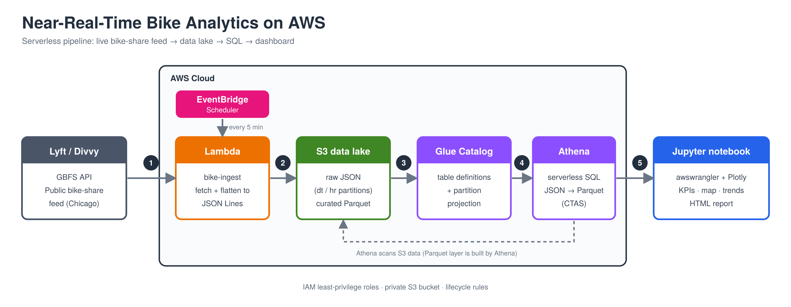

# Near-Real-Time Bike Analytics on AWS
 
A serverless data pipeline that ingests the live Lyft/Divvy (Chicago) bike-share feed every 5 minutes, stores it in an S3 data lake, queries it with Athena, and presents an operations dashboard that answers one question:
 
> **Which stations are about to run empty or full, and which equipment is out of service?**

## How it works
 
1. **Ingest:** EventBridge triggers a Lambda every 5 minutes. It fetches `station_status` (every run) and `station_information` (at most once per 24 h), flattens them to JSON Lines, and writes timestamped, immutable objects to S3.
2. **Store:** data lands in `raw/station_status/dt=YYYY-MM-DD/hr=HH/`. A 7-day lifecycle rule caps storage.
3. **Catalog and query:** tables are defined with explicit DDL in the Glue Data Catalog. The fact table uses Athena *partition projection*, so new hourly folders are queryable instantly with no crawler. A view joins status with station capacity.
4. **Optimize:** an Athena CTAS converts the raw JSON into partitioned Parquet.
5. **Present:** a notebook runs tagged Athena queries and renders interactive Plotly charts, which can be exported to a self-contained HTML report.

## Data and attribution
 
Data comes from the public [GBFS](https://gbfs.org/) feed published by Lyft/Divvy. This project is independent and is not affiliated with or endorsed by Lyft or Divvy. Check the feed's terms of use before redistributing data.
 
## License
 
[MIT](LICENSE)
